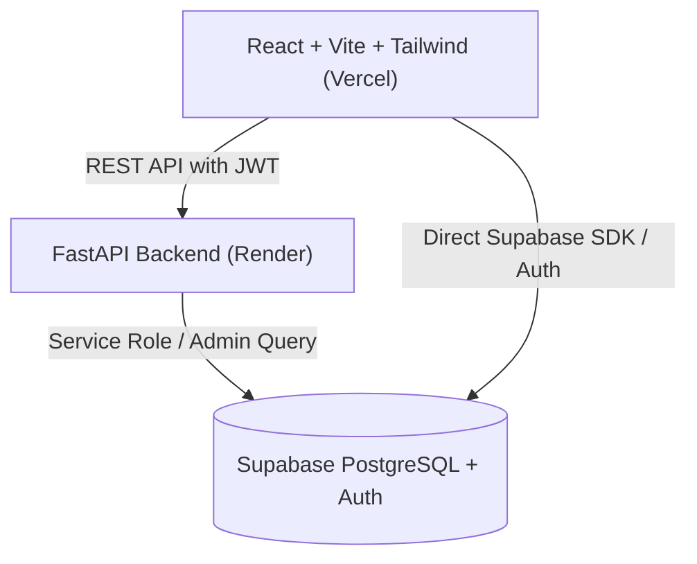

# 🎓 CampusSphere — Comprehensive Setup & Deployment Guide

This guide walks you through setting up **CampusSphere** from scratch and deploying both the backend and frontend for **100% free**.

---

## 🏗️ Architecture Overview



- **Frontend**: React 18, Vite, TypeScript, Tailwind CSS, Lucide icons (Free on **Vercel**)
- **Backend**: FastAPI, Pydantic v2, Uvicorn, Supabase Python Client (Free on **Render**)
- **Database**: Supabase PostgreSQL with Row Level Security (Free on **Supabase**)

---

## 1. 🗄️ Supabase Setup (Free Database & Auth)

1. Go to [supabase.com](https://supabase.com) and sign in / sign up (free).
2. Click **New project**:
   - Choose any name (e.g. `campussphere`)
   - Enter a database password and save it
   - Choose the region nearest to you (e.g. `Mumbai` / `ap-south-1` or `Singapore`)
   - Click **Create new project** (takes ~1 minute to provision)
3. Open the **SQL Editor** from the left navigation.
4. Copy all contents of [`campussphere-backend/supabase_schema.sql`](file:///D:/Dka%20maal/NIT/Sem%205/SE/SELab/campussphere-backend/supabase_schema.sql) and paste into the SQL editor.
5. Click **Run**. All 8 tables, constraints, and Row Level Security policies will be created immediately!
6. Navigate to **Project Settings** → **API** to copy your credentials:
   - **Project URL** (e.g. `https://xyzproject.supabase.co`)
   - **anon / public key** (client-side safe)
   - **service_role key** (secret key for FastAPI admin operations)

---

## 2. 💻 Local Development Setup

### Backend (FastAPI)
1. Navigate to the backend directory:
   ```bash
   cd campussphere-backend
   ```
2. Create and activate a virtual environment (optional but recommended):
   ```bash
   python -m venv venv
   # On Windows PowerShell:
   .\venv\Scripts\Activate.ps1
   # On macOS/Linux:
   source venv/bin/activate
   ```
3. Install dependencies:
   ```bash
   pip install -r requirements.txt
   ```
4. Create `.env` file from `.env.example`:
   ```bash
   cp .env.example .env
   ```
   Fill in your values:
   ```env
   SUPABASE_URL=https://your-project.supabase.co
   SUPABASE_KEY=your-supabase-anon-key
   SUPABASE_SERVICE_KEY=your-supabase-service-role-key
   FRONTEND_URL=http://localhost:5173
   ```
5. Run the FastAPI development server:
   ```bash
   uvicorn app.main:app --reload --port 8000
   ```
   - API Docs will be live at: [http://localhost:8000/docs](http://localhost:8000/docs)
   - Health check: [http://localhost:8000/health](http://localhost:8000/health)

---

### Frontend (React + Vite)
1. Navigate to the frontend directory:
   ```bash
   cd campussphere-frontend
   ```
2. Install dependencies (already installed in workspace, but if on a new machine):
   ```bash
   npm install
   ```
3. Create `.env` file from `.env.example`:
   ```bash
   cp .env.example .env
   ```
   Fill in your values:
   ```env
   VITE_SUPABASE_URL=https://your-project.supabase.co
   VITE_SUPABASE_ANON_KEY=your-supabase-anon-key
   VITE_API_URL=http://localhost:8000
   ```
4. Start development server:
   ```bash
   npm run dev
   ```
   Open [http://localhost:5173](http://localhost:5173) in your browser!

---

## 3. 🚀 Free Production Deployment

### A. Backend on Render.com (100% Free)
1. Push your repository to **GitHub** (e.g., repository `CampusSphere`).
2. Go to [render.com](https://render.com) and log in.
3. Click **New +** → **Web Service**.
4. Connect your GitHub repository.
5. Configure the service:
   - **Name**: `campussphere-api`
   - **Root Directory**: `campussphere-backend`
   - **Runtime**: `Python 3`
   - **Build Command**: `pip install -r requirements.txt`
   - **Start Command**: `uvicorn app.main:app --host 0.0.0.0 --port $PORT`
   - **Plan Type**: `Free`
6. Under **Environment Variables**, add:
   - `SUPABASE_URL` = your Supabase URL
   - `SUPABASE_KEY` = your Supabase Anon Key
   - `SUPABASE_SERVICE_KEY` = your Supabase Service Role Key
   - `FRONTEND_URL` = `https://your-app.vercel.app` (or `*` during initial setup)
7. Click **Create Web Service**.
   Render will deploy your backend in ~2 minutes and provide a URL like:
   `https://campussphere-api.onrender.com`

---

### B. Frontend on Vercel (100% Free)
1. Go to [vercel.com](https://vercel.com) and log in with GitHub.
2. Click **Add New...** → **Project**.
3. Import your GitHub repository.
4. In project configuration:
   - **Root Directory**: Click edit and select `campussphere-frontend`
   - **Framework Preset**: `Vite` (automatically detected)
   - **Build Command**: `npm run build`
   - **Output Directory**: `dist`
5. Under **Environment Variables**, add:
   - `VITE_SUPABASE_URL` = your Supabase URL
   - `VITE_SUPABASE_ANON_KEY` = your Supabase Anon Key
   - `VITE_API_URL` = your Render backend URL (e.g., `https://campussphere-api.onrender.com`)
6. Click **Deploy**.
   Vercel will build and deploy your app in < 1 minute with a free `*.vercel.app` domain and automatic SSL!

---

## 📦 What Was Built

| Module | Features |
|---|---|
| **User Authentication** | Supabase Auth integration, JWT token management, Student & Admin roles, Profile view & edit |
| **Events Hub** | Event discovery, chronological sorting, RSVP system, attendee limits, admin event creation/management |
| **Clubs Directory** | Explore student clubs, join/leave membership, member roster, club-specific events |
| **Announcements** | Campus-wide broadcast notices, pinned announcements prioritizer, rich text display |
| **Lost & Found** | Post lost & found listings, photo upload/URL, filter by status (open/resolved), mark resolved |
| **Academic Resources** | Filter by subject, share notes/docs/links/videos, download/open external resources |
| **Dashboard** | Unified overview showing campus stats, upcoming events, and urgent announcements |
